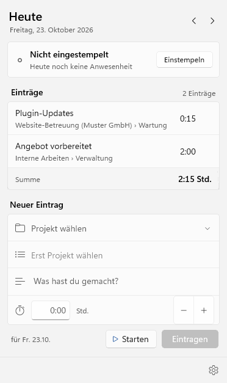
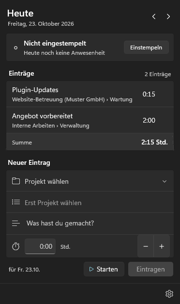
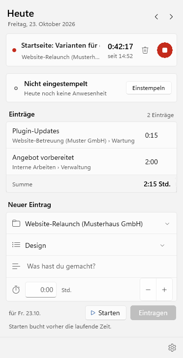
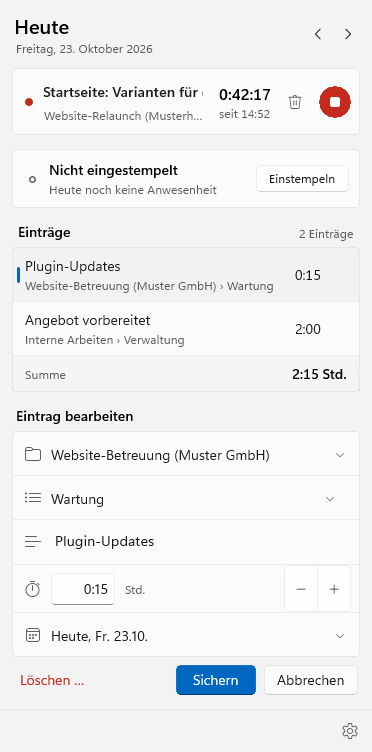
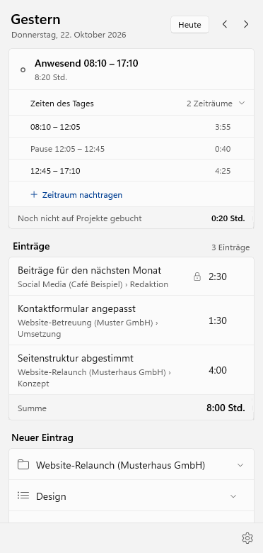
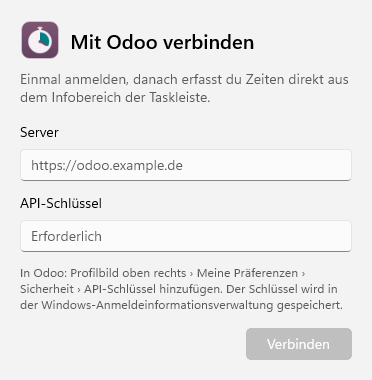
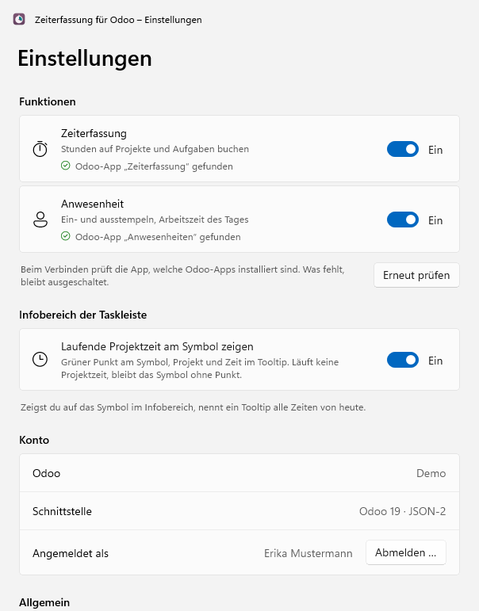

# Zeiterfassung für Odoo – Windows

Eigene Stunden und Anwesenheit in Odoo direkt aus dem Infobereich der Windows-Taskleiste
erfassen: Projekt und Aufgabe wählen, Dauer eintragen oder die Zeit mit Starten und Stoppen
messen. Ein- und Ausstempeln mit einem Klick; ein Klick auf die Uhr neben der Systemuhr öffnet
das Fenster, ein Rechtsklick das Menü.

Die Windows-Fassung der [Mac-App](https://github.com/BM1-de/timesheets-for-odoo): dieselben
Abläufe, dieselben Texte und dieselben Tests, umgesetzt mit WinUI 3.

> **Alpha:** Die App ist neu und wird bei der Baumgärtner Marketing GmbH erprobt. Sie wird ohne
> Gewährleistung bereitgestellt (AGPL-3.0, Abschnitte 15 und 16).

<p>
  
  
</p>

## Was die App kann

- **Zeiteinträge:** Projekt (mit Suche, zuletzt verwendete oben), Aufgabe, Beschreibung und
  Dauer. Die Dauer versteht `1:30`, `1,5`, `90 min` oder `1h30`, auch mit englischen und
  französischen Einheiten (`2 hours`, `1 heure 30`), und wird auf 15, 30 oder 60 Minuten gerundet
  (ab Werk 15) oder gar nicht. Die Einträge des Tages stehen mit Summe darüber; frühere Tage lassen
  sich durchblättern und nachtragen.
- **Projekt-Timer:** Ohne Dauer startet „Starten“ im Formular die Zeit für Projekt, Aufgabe und
  Beschreibung, auch ganz ohne Angaben; was fehlt, wählst du, während sie läuft, oder beim
  Stoppen im Formular, das dann mit der gemessenen Dauer bucht. ▶ an einem Eintrag startet
  dieselbe Arbeit erneut. Es läuft immer nur eine Zeit, ein neuer Start bucht die laufende.
  Stoppen bucht sofort auf den Tag, an dem die Zeit begann, gerundet wie eingestellt; lief sie
  keine Minute, kommt sie ins Formular, verloren geht nichts. Die Zeit läuft weiter, wenn die
  App beendet wird.
- **Bearbeiten:** Ein Klick auf einen Eintrag öffnet ihn unten im Formular, auch um ihn auf einen
  anderen Tag zu legen; löschen geht nach einer Rückfrage. Abgerechnete Einträge sperrt Odoo bis
  auf die Beschreibung, die App zeigt das.
- **Anwesenheit:** ein- und ausstempeln, die Zeiten und Pausen des Tages und wie viel davon noch
  nicht auf Projekte gebucht ist. Mit dem Recht dazu lassen sich Zeiten korrigieren, Pausen
  verschieben, vergessene Zeiten nachtragen und Zeiträume löschen. Hat Odoo automatisch
  ausgestempelt, markiert die App die Zeit zum Korrigieren.
- **Mehrere Firmen:** Die Projektauswahl ordnet die Projekte nach Firma, die Einträge eines Tages
  stehen je Firma mit Zwischensumme. Odoo bucht jeden Eintrag in der Firma seines Projekts; wer in
  mehreren Firmen einen Mitarbeiter hat, wählt in den Einstellungen, für welche Firma er stempelt.
- **Modul „Arbeitszeitgesetz“ (optional):** Ist es in Odoo installiert, erkennt die App die
  Pausen, die Odoo selbst einfügt, und rechnet beim Verschieben einer Pause vor, ob sie reicht.
- **Infobereich:** Ein grüner Punkt an der Uhr zeigt, dass eine Projektzeit läuft (abschaltbar).
  Der Tooltip nennt die laufende Zeit, die Projektzeit und die Anwesenheit von heute. Im Menü
  des Rechtsklicks stoppt *Stoppen und buchen* die laufende Zeit, ohne das Fenster zu öffnen.
- **Funktionen einzeln:** Zeiterfassung und Anwesenheit lassen sich getrennt einschalten. Beim
  Verbinden prüft die App, welche Odoo-Apps installiert sind und welche Rechte der Benutzer hat;
  was fehlt, bleibt mit Begründung ausgeschaltet.
- **Windows-typisch:** hell und dunkel, Akzentfarbe des Systems, Fenster mit Acryl und Mica wie
  die Flyouts von Windows 11. Tastatur: `Eingabe` trägt ein, `Esc` bricht ab oder schließt das
  Fenster, `Alt+←` und `Alt+→` blättern, `Alt+Pos1` springt zu heute, `F5` oder `Strg+R` lädt
  neu, `Strg+,` öffnet die Einstellungen. Beschriftungen für die Sprachausgabe.
- **Updates:** kommen über den Microsoft Store.
- **Sprachen:** Deutsch, Englisch und Französisch, nach der Sprache von Windows. Datum und Uhrzeit
  folgen der eingestellten Region, auch mit 12-Stunden-Uhr.

<p>
  
  
</p>
<p>
  
</p>

## Voraussetzungen

- Windows 10 Version 2004 oder neuer oder Windows 11, x64 oder ARM64
- Odoo 17, 18 oder 19, Community oder Enterprise, selbst betrieben, auf Odoo.sh oder Odoo Online
- die Odoo-Apps *Zeiterfassung* und/oder *Anwesenheiten*; der Odoo-Benutzer muss mit einem
  Mitarbeiter verknüpft sein
- ein API-Schlüssel des eigenen Odoo-Benutzers

## Einrichtung

1. App starten. Windows 11 legt neue Symbole zunächst in den Überlauf (der Pfeil `^` neben der
   Systemuhr). Damit die Uhr immer zu sehen ist: *Einstellungen › Personalisierung › Taskleiste ›
   Andere Symbole der Taskleiste* und dort *Zeiterfassung für Odoo* einschalten.
2. Auf die Uhr klicken, Serveradresse und API-Schlüssel eintragen. Den Schlüssel erstellt man in
   Odoo über das Profilbild oben rechts › *Meine Präferenzen* › *Sicherheit* › *API-Schlüssel
   hinzufügen* (Odoo 17 und 18: *Mein Profil* › *Kontosicherheit* › *Neuer API-Schlüssel*). Er wird
   in der Anmeldeinformationsverwaltung von Windows gespeichert.
3. Bei Odoo 17 und 18 fragt die App zusätzlich nach dem Benutzernamen, bei mehreren Datenbanken
   auf einem Server nach deren Namen.

Läuft der API-Schlüssel ab, meldet die App das und bittet um einen neuen.

**Ohne Odoo ausprobieren:** als Server `demo` und als API-Schlüssel `demo` eintragen. Die App
zeigt dann erfundene Projekte und Einträge in ihrer Sprache. Was man bucht oder stempelt, bleibt
bis zum Beenden der App erhalten und verlässt den Rechner nicht.

<p>
  
  
</p>

## Rechte in Odoo

- **Zeiteinträge:** Das Grundrecht der Zeiterfassung („nur eigene Zeiterfassungen“) genügt, auch
  zum Ändern und Löschen der eigenen Einträge. Abgerechnete Einträge sperrt Odoo bis auf die
  Beschreibung, freigegebene (Odoo Enterprise) ganz.
- **Stempeln und Korrigieren:** Über die Schnittstelle erlaubt Odoo das Anlegen und Ändern von
  Anwesenheiten nur mit dem Recht *Sachbearbeiter: Alle Anwesenheiten verwalten* oder als
  Administrator, außerdem wenn man beim eigenen Mitarbeiter als *Anwesenheitsgenehmiger*
  eingetragen ist. Ohne dieses Recht zeigt die App die Anwesenheit nur an und weist darauf hin;
  gestempelt wird dann weiter in Odoo, Korrekturen trägt die zuständige Person ein.
- Wer nur die Anwesenheiten anderer genehmigt, hat in Odoo das Recht *Sachbearbeiter:
  Anwesenheiten verwalten*, darf aber nicht für sich selbst stempeln. Das zeigt Odoo erst beim
  Versuch; die App blendet das Stempeln dann aus. Nach einer Änderung der Rechte in den
  Einstellungen auf *Erneut prüfen* klicken.

## Wie die App mit Odoo spricht

- **Odoo 19:** die Schnittstelle JSON-2 (`/json/2/<Modell>/<Methode>`) mit dem API-Schlüssel.
- **Odoo 17 und 18** sowie Odoo Online ohne JSON-2: die ältere Schnittstelle JSON-RPC
  (`/jsonrpc`) mit Benutzername und API-Schlüssel. Odoo hat sie mit Version 19 abgekündigt und
  will sie mit Odoo 22 entfernen.
- Alle Aufrufe laufen mit den Rechten des angemeldeten Benutzers. Gelesen werden der eigene
  Benutzer mit seinen Firmen und Mitarbeitern, Projekte, Aufgaben, die eigenen Zeiteinträge und
  Anwesenheiten; geschrieben werden nur die eigenen Zeiteinträge und Anwesenheiten.
- Der API-Schlüssel liegt in der Anmeldeinformationsverwaltung von Windows, die übrigen
  Einstellungen in den Daten der App. Die App verbindet sich nur mit dem eigenen Odoo und sammelt
  keine Nutzungsdaten.
- Unverschlüsselte Adressen (`http://`) sind nur für `localhost` erlaubt.
- Leitet der Server auf eine andere Adresse um, folgt die App nicht, damit der API-Schlüssel nur
  an die eingetragene Adresse geht. Sie nennt stattdessen die Zieladresse.
- Ohne Verbindung versucht die App es selbst erneut, erst nach Sekunden, dann in wachsenden
  Abständen bis fünf Minuten. Bleibt beim Speichern die Antwort aus, prüft sie vor dem nächsten
  Versuch, ob der Eintrag schon in Odoo angekommen ist, und legt ihn nicht doppelt an.

## Installation

Die App kommt aus dem Microsoft Store:
[Zeiterfassung für Odoo](https://apps.microsoft.com/detail/9PLPXXJ8QH0Q) (der Eintrag erscheint,
sobald Microsoft die erste Version freigegeben hat). In der Eingabeaufforderung geht es auch mit

```powershell
winget install --id 9PLPXXJ8QH0Q --source msstore
```

Sie steht danach im Startmenü, Updates kommen über den Store. *Mit Windows starten* schaltet man in
den Einstellungen der App ein. Texte und Angaben für den Eintrag stehen in
[docs/store.md](docs/store.md).

## Selbst bauen

Unter Windows mit dem .NET 10 SDK und MSBuild aus Visual Studio 2026 oder den Build Tools. Das MSIX-Paket für
x64:

```powershell
msbuild src/Zeiterfassung.App/Zeiterfassung.App.csproj /restore /p:Configuration=Release /p:Platform=x64 /p:RuntimeIdentifier=win-x64 /p:GenerateAppxPackageOnBuild=true /p:UapAppxPackageBuildMode=SideloadOnly /p:AppxBundle=Never
```

Windows installiert das Paket nur signiert. Zum Ausprobieren genügt ein selbst ausgestelltes Zertifikat auf den
Herausgeber aus `Package.appxmanifest`, dem der Rechner vertraut; so macht es die Prüfung auf GitHub in
[`.github/workflows/build.yml`](.github/workflows/build.yml). In Visual Studio installiert *Bereitstellen* die App
direkt. Ohne Paket startet die App nicht: WinUI findet dann seine Ressourcen nicht. Veröffentlicht wird über GitHub
Actions, siehe [RELEASE.md](RELEASE.md).

## Entwicklung

- `src/Zeiterfassung.Core`: Odoo-Anbindung, App-Logik und Texte, ohne Oberfläche (`net10.0`, baut
  und testet auch auf macOS und Linux). `src/Zeiterfassung.App`: Oberfläche mit WinUI 3 und dem
  Windows App SDK, Symbol im Infobereich, Anmeldeinformationen, Autostart und Updates.
- Tests: `dotnet test --project tests/Zeiterfassung.Core.Tests`. Es sind die Tests der Mac-App,
  übertragen auf C#; sie laufen gegen ein simuliertes Odoo im Arbeitsspeicher.
- Ohne Windows: `scripts/check-app.sh` kompiliert den C#-Teil der App auch auf macOS und Linux;
  Platzhalter ersetzen den Code, den der XAML-Compiler erzeugt. XAML selbst prüft erst der Bau unter Windows.
- Übersetzungen: `Localization/Localizable.xcstrings` ist der Katalog der Mac-App, unverändert
  übernommen; Ausgangssprache Deutsch, dazu Englisch und Französisch. `Windows.xcstrings` enthält
  die Texte, die es nur unter Windows gibt, und ersetzt einzelne Sprachen eines Mac-Textes, wo
  Windows andere Begriffe nutzt („Paramètres“ statt „Réglages“). Texte im Code stehen auf Deutsch
  in `Loc.T("…")`, in XAML als `{z:Str Key='…'}`. Der Test „Sprachen“ prüft, ob jeder Text in
  jeder Sprache vorliegt.
- Bildschirmfotos: `Zeiterfassung.exe --screenshots <Ordner> [--language de|en|fr] [--theme dark]` zeichnet
  die wichtigsten Zustände mit erfundenen Daten und fester Uhrzeit in PNG-Dateien und beendet sich; dazu ein
  Protokoll mit den Tooltips. Die installierte App ist über diesen Namen erreichbar (Ausführungsalias). GitHub
  Actions installiert bei jedem Bau das Paket, zeichnet die Bilder auf Deutsch hell und dunkel sowie auf Englisch
  und legt sie als Artefakt `bilder` ab.
- Symbole: `python3 scripts/make-assets.py` erzeugt Kacheln, App-Symbol und die Symbole für den
  Infobereich aus den SVG-Dateien in `design/symbole` (braucht `rsvg-convert`).

## Grenzen

- Der Projekt-Timer läuft in der App, nicht in Odoo: Er erscheint nicht im Timer von Odoo
  Enterprise und nicht auf anderen Geräten.
- Sprachen: Deutsch, Englisch, Französisch. Steht keine davon in der Sprachliste von Windows,
  erscheint die App auf Englisch.
- Ein Odoo-Konto je Windows-Benutzer.

## Marke

Odoo ist eine Marke der Odoo S.A. Dieses Projekt ist unabhängig und steht in keiner Verbindung
zu Odoo S.A. Das App-Symbol ist eigenes Werk und verwendet kein Logo von Odoo.

## Lizenz

Copyright © 2026 Baumgärtner Marketing GmbH. Lizenziert unter der
[GNU Affero General Public License, Version 3 oder neuer](LICENSE).

Die App enthält das [Windows App SDK](https://github.com/microsoft/WindowsAppSDK) von Microsoft, das unter den
Lizenzbedingungen von Microsoft steht und mit dem Paket ausgeliefert wird. Damit das neben der AGPL zulässig ist,
gilt diese zusätzliche Erlaubnis nach Abschnitt 7 der AGPL:

> Additional permission under GNU AGPL version 3 section 7: If you modify this Program, or any covered work, by
> linking or combining it with the Microsoft Windows App SDK (or a modified version of that library), containing
> parts covered by the terms of the Microsoft Software License Terms for the Windows App SDK, the licensors of this
> Program grant you additional permission to convey the resulting work.

*English: A Windows system tray app to log your own timesheets and attendance in Odoo 17–19:
pick project and task, enter the duration or time it with start and stop, check in and out with
one click. Uses JSON-2 (Odoo 19) or JSON-RPC (Odoo 17/18) with a personal API key stored in the
Windows Credential Manager. The Windows version of the macOS menu bar app, built with WinUI 3.
User interface in German, English and French. Alpha, AGPL-3.0, no warranty. Not affiliated with
Odoo S.A.*
